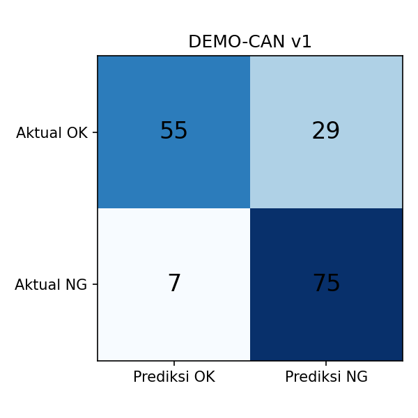
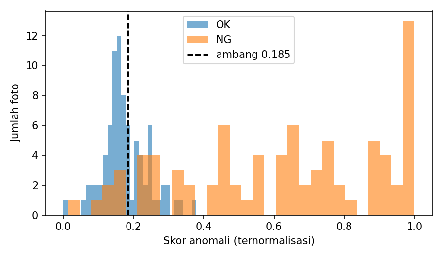

# Evaluasi model DEMO-CAN v1

Set uji terpisah: 84 OK, 82 NG (manifest `/mnt/storage/simonpro/data/manifests/DEMO-CAN.csv`).

| Ukuran | Nilai | Target | Status |
|---|---|---|---|
| Recall NG (K2) | 91.5% | ≥ 90% | Lulus |
| Specificity (K3) | 65.5% | ≥ 85% | Belum |
| Latensi inferensi p95 (AI-04) | 215.9 ms | ≤ 500 ms | Lulus |
| AUROC | 0.9216 | — | — |

Ambang batas 0.1850 (ternormalisasi), perangkat: cpu.
Confusion: TP=75 FN=7 TN=55 FP=29.

 

## Salah klasifikasi (36)

- `006_004.jpg` aktual OK , skor 0.230
- `007_002.jpg` aktual OK , skor 0.222
- `042_002.jpg` aktual OK , skor 0.251
- `047_001.jpg` aktual OK , skor 0.300
- `047_003.jpg` aktual OK , skor 0.213
- `049_004.jpg` aktual OK , skor 0.379
- `052_002.jpg` aktual OK , skor 0.250
- `052_004.jpg` aktual OK , skor 0.203
- `053_003.jpg` aktual OK , skor 0.241
- `055_002.jpg` aktual OK , skor 0.203
- `055_004.jpg` aktual OK , skor 0.207
- `058_002.jpg` aktual OK , skor 0.336
- `058_004.jpg` aktual OK , skor 0.278
- `065_002.jpg` aktual OK , skor 0.202
- `067_002.jpg` aktual OK , skor 0.243
- `070_004.jpg` aktual OK , skor 0.293
- `071_003.jpg` aktual OK , skor 0.318
- `073_002.jpg` aktual OK , skor 0.225
- `002_024.jpg` aktual NG surface_damage, skor 0.154
- `002_025.jpg` aktual NG surface_damage, skor 0.013
- `014_004.jpg` aktual OK , skor 0.212
- `014_006.jpg` aktual NG surface_damage, skor 0.172
- `015_004.jpg` aktual OK , skor 0.245
- `015_012.jpg` aktual OK , skor 0.187
- `018_002.jpg` aktual OK , skor 0.278
- `019_004.jpg` aktual OK , skor 0.218
- `019_006.jpg` aktual OK , skor 0.256
- `019_010.jpg` aktual NG surface_damage, skor 0.114
- `019_011.jpg` aktual NG surface_damage, skor 0.094
- `025_023.jpg` aktual OK , skor 0.188
- `025_024.jpg` aktual OK , skor 0.270
- `025_025.jpg` aktual NG surface_damage, skor 0.140
- `026_027.jpg` aktual OK , skor 0.246
- `026_029.jpg` aktual NG surface_damage, skor 0.167
- `050_001.jpg` aktual OK , skor 0.237
- `050_003.jpg` aktual OK , skor 0.223
