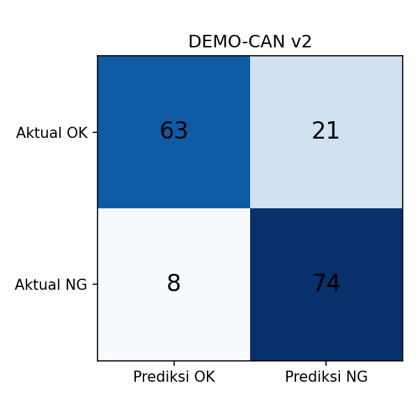
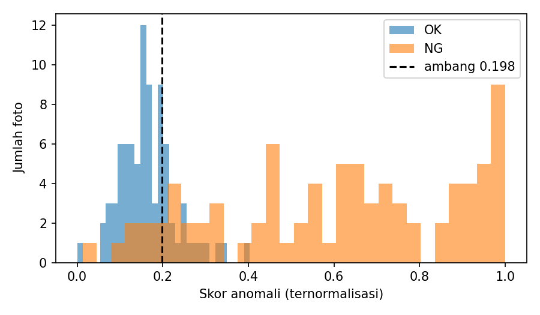

# Evaluasi model DEMO-CAN v2

Set uji terpisah: 84 OK, 82 NG (manifest `/mnt/storage/simonpro/data/manifests/DEMO-CAN.csv`).

| Ukuran | Nilai | Target | Status |
|---|---|---|---|
| Recall NG (K2) | 90.2% | ≥ 90% | Lulus |
| Specificity (K3) | 75.0% | ≥ 85% | Belum |
| Latensi inferensi p95 (AI-04) | 42.8 ms | ≤ 500 ms | Lulus |
| AUROC | 0.9268 | — | — |

Ambang batas 0.1979 (ternormalisasi), perangkat: NVIDIA GeForce RTX 4060 Laptop GPU.
Confusion: TP=74 FN=8 TN=63 FP=21.

 

## Salah klasifikasi (29)

- `003_004.jpg` aktual OK , skor 0.220
- `007_002.jpg` aktual OK , skor 0.346
- `047_001.jpg` aktual OK , skor 0.266
- `047_003.jpg` aktual OK , skor 0.244
- `049_004.jpg` aktual OK , skor 0.403
- `052_004.jpg` aktual OK , skor 0.199
- `053_003.jpg` aktual OK , skor 0.236
- `055_002.jpg` aktual OK , skor 0.298
- `055_004.jpg` aktual OK , skor 0.204
- `058_002.jpg` aktual OK , skor 0.330
- `058_004.jpg` aktual OK , skor 0.209
- `070_004.jpg` aktual OK , skor 0.289
- `073_002.jpg` aktual OK , skor 0.221
- `073_004.jpg` aktual OK , skor 0.243
- `001_006.jpg` aktual OK , skor 0.199
- `002_024.jpg` aktual NG surface_damage, skor 0.115
- `002_025.jpg` aktual NG surface_damage, skor 0.013
- `002_026.jpg` aktual NG surface_damage, skor 0.155
- `014_004.jpg` aktual OK , skor 0.208
- `014_006.jpg` aktual NG surface_damage, skor 0.164
- `015_006.jpg` aktual NG surface_damage, skor 0.190
- `016_004.jpg` aktual OK , skor 0.209
- `018_002.jpg` aktual OK , skor 0.281
- `019_004.jpg` aktual OK , skor 0.214
- `019_006.jpg` aktual OK , skor 0.252
- `019_011.jpg` aktual NG surface_damage, skor 0.092
- `025_025.jpg` aktual NG surface_damage, skor 0.121
- `026_027.jpg` aktual OK , skor 0.209
- `026_029.jpg` aktual NG surface_damage, skor 0.188
