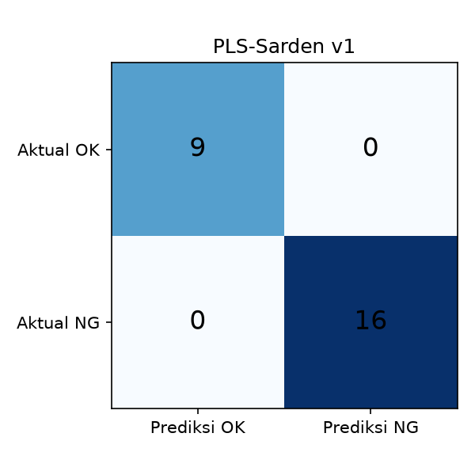
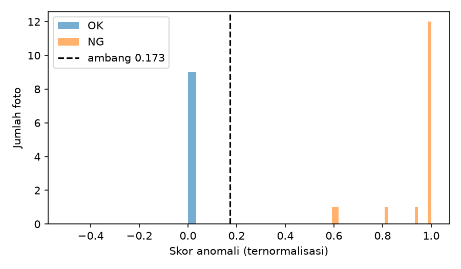

# Evaluasi model PLS-Sarden v1

Set uji terpisah: 9 OK, 16 NG (manifest `/home/pn/.local/share/simonpro/data/manifests/PLS-Sarden.csv`).

| Ukuran | Nilai | Target | Status |
|---|---|---|---|
| Recall NG (K2) | 100.0% | ≥ 90% | Lulus |
| Specificity (K3) | 100.0% | ≥ 85% | Lulus |
| Latensi inferensi p95 (AI-04) | 313.2 ms | ≤ 500 ms | Lulus |
| AUROC | 1.0000 | — | — |

Ambang batas 0.1730 (ternormalisasi), perangkat: cpu.
Confusion: TP=16 FN=0 TN=9 FP=0.

 

## Salah klasifikasi (0)

